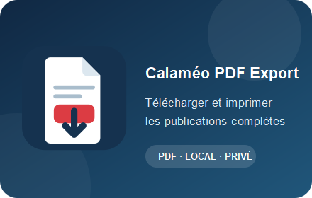

<div align="center">

# Calaméo PDF Export

Télécharge ou imprime les publications Calaméo complètes, directement depuis le lecteur.

[](https://github.com/elig-45/calameo-pdf-export/releases/latest/download/calameo-pdf-export-0.3.0-firefox.zip)
[](https://github.com/elig-45/calameo-pdf-export/releases/latest/download/calameo-pdf-export-0.3.0-chromium.zip)
[](https://brave.com/)
[](https://github.com/elig-45/calameo-pdf-export/releases/latest)



</div>

## Intégration dans Calaméo

La barre d’outils du lecteur intègre les actions natives **Télécharger** et **Imprimer**. Si Calaméo les désactive, l’extension les active pour proposer le PDF complet.

## Navigateurs compatibles

| Navigateur | État | Installation |
| --- | --- | --- |
| Firefox | Firefox 140+ | [Télécharger depuis GitHub](https://github.com/elig-45/calameo-pdf-export/releases/latest/download/calameo-pdf-export-0.3.0-firefox.zip) |
| Microsoft Edge | Compatible Chromium | [Télécharger depuis GitHub](https://github.com/elig-45/calameo-pdf-export/releases/latest/download/calameo-pdf-export-0.3.0-chromium.zip) |
| Brave | Testé | [Dernière release](https://github.com/elig-45/calameo-pdf-export/releases/latest) |
| Google Chrome | Compatible Chromium 121+ | [Dernière release](https://github.com/elig-45/calameo-pdf-export/releases/latest) |

## Fonctionnalités

- Active **Télécharger** et **Imprimer** quand Calaméo désactive ces boutons.
- Crée un PDF de la publication complète ou d’une sélection de pages, par exemple `1-3, 8, 12-15`.
- Prépare discrètement le PDF complet en arrière-plan pour réduire l’attente au clic.
- **Ctrl+P** et le bouton natif **Imprimer** ouvrent la boîte d’impression du navigateur pour le PDF complet, sans afficher de lecteur ou de barre supplémentaire.
- Assemble les pages localement, sans service de conversion ni compte.
- Affiche la progression et permet d’annuler un export.

## Utilisation

1. Ouvre une publication sur `calameo.com/read/...`.
2. Clique sur **Télécharger** lorsque tu veux enregistrer le PDF, ou sur **Imprimer** / **Ctrl+P** pour imprimer toute la publication.
3. Pour une sélection, choisis **Une sélection**, puis saisis les numéros ou plages séparés par des virgules.

Les plages sont triées et les doublons supprimés. Les numéros doivent être compris entre la première et la dernière page.

## Confidentialité

- Les pages sont lues depuis les serveurs d’images Calaméo déjà utilisés par le lecteur.
- Le PDF est créé dans le navigateur ; aucun fichier n’est envoyé à un service tiers.
- Le lien signé fourni par le lecteur sert aux requêtes de pages et n’est pas enregistré.
- Le PDF complet préparé est stocké localement dans l’extension pendant sept jours au maximum.
- L’extension n’utilise ni compte, ni analytics, ni suivi.

## Limites

- Le lecteur doit avoir chargé au moins une page et exposer le nombre total de pages.
- Les pages doivent rester accessibles avec le lien fourni pendant la session Calaméo.
- Les PDF sont des documents image : le texte OCR, les liens et les médias interactifs ne sont pas ajoutés.
- La préparation silencieuse couvre jusqu’à 500 pages ; **Ctrl+P** peut préparer jusqu’à 2 000 pages et 128 Mio. Pour les publications plus volumineuses, utilise l’export PDF du bouton **Télécharger**.

## Développement

Le dépôt contient la variante Chromium dans `manifest.json`. Le script de build génère les archives Chromium (Edge, Brave, Chrome) et Firefox :

```bash
node scripts/build.mjs
```

Pour charger une version locale, ouvre la page des extensions du navigateur, active le mode développeur, puis charge le dossier du navigateur (`dist/package-chromium` ou `dist/package-firefox`). Après une modification du code, recharge l’extension et l’onglet Calaméo.

## Fichiers

- `content.js` : boutons du lecteur, panneau d’export et raccourci d’impression.
- `background.js` : messages, téléchargements et compatibilité avec les contextes de fond.
- `offscreen.js` : lecture des pages Calaméo et génération du PDF.
- `print.html` / `print.js` : rendu du PDF complet pour l’impression native.
- `scripts/build.mjs` : création des paquets Chromium et Firefox.
